# Infraestructura en dos niveles con Vagrant: Apache y MariaDB

**Autor:** Marcos Muñoz Barroso
**Ciclo:** 2.º ASIR (Administración de Sistemas Informáticos en Red) · IES Albarregas
**Módulo:** Implantación de Aplicaciones Web
**Curso:** 2026/2027

---

## Índice

1. [Introducción](#1-introducción)
2. [Requisitos previos](#2-requisitos-previos)
3. [Estructura del repositorio](#3-estructura-del-repositorio)
4. [El fichero Vagrantfile](#4-el-fichero-vagrantfile)
5. [Scripts de aprovisionamiento](#5-scripts-de-aprovisionamiento)
   - [5.1 mysql.sh](#51-mysqlsh)
   - [5.2 sin_internet.sh](#52-sin_internetsh)
   - [5.3 apache.sh](#53-apachesh)
6. [Ajustes realizados en la aplicación](#6-ajustes-realizados-en-la-aplicación)
7. [Puesta en marcha](#7-puesta-en-marcha)
8. [Comprobaciones](#8-comprobaciones)
   - [8.1 Estado de las máquinas](#81-estado-de-las-máquinas)
   - [8.2 Nombres de las máquinas](#82-nombres-de-las-máquinas)
   - [8.3 Servicios en ejecución](#83-servicios-en-ejecución)
   - [8.4 Conectividad de red](#84-conectividad-de-red)
   - [8.5 Configuración de la aplicación](#85-configuración-de-la-aplicación)
   - [8.6 Base de datos](#86-base-de-datos)
   - [8.7 La aplicación en el navegador](#87-la-aplicación-en-el-navegador)
9. [Screencast](#9-screencast)
10. [Aclaraciones](#10-aclaraciones)

---

## 1. Introducción

El objetivo de esta práctica es montar con **Vagrant** una infraestructura web en **dos niveles** y desplegar en ella una aplicación de gestión de usuarios (alta, edición y borrado de registros) desarrollada en PHP con base de datos.

La aplicación utilizada es la del repositorio [josejuansanchez/iaw-practica-lamp](https://github.com/josejuansanchez/iaw-practica-lamp).

La infraestructura está formada por dos máquinas virtuales Debian 12 (*bookworm*) que se ejecutan en VirtualBox:

| Máquina | Nombre (hostname) | Función | IP de la red interna | Acceso a Internet |
|---|---|---|---|---|
| `apache` | `MarcosMunozBarrosoApache` | Servidor web (Apache + PHP) | 192.168.56.10 | Sí (NAT) |
| `mysql` | `MarcosMunozBarrosoMysql` | Servidor de base de datos (MariaDB) | 192.168.56.11 | No |

Esquema de la infraestructura:

```
                 Equipo anfitrión (Fedora)
                  http://localhost:8080
                           │  reenvío de puertos (8080 → 80)
                           ▼
               ┌───────────────────────┐        red interna         ┌───────────────────────┐
  Internet ◄───┤  MarcosMunozBarroso   ├────────────────────────────┤  MarcosMunozBarroso   │
     (NAT)     │        Apache         │   192.168.56.0/24          │         Mysql         │
               │    192.168.56.10      │                            │    192.168.56.11      │
               └───────────────────────┘                            └───────────────────────┘
                  Nivel 1: servidor web                               Nivel 2: base de datos
                                                                      (sin salida a Internet)
```

Los requisitos que cumple la práctica son:

- Solo la máquina Apache tiene acceso a Internet a través de NAT.
- La máquina de la base de datos no tiene salida a Internet.
- El acceso a la aplicación desde el equipo anfitrión se realiza mediante **reenvío de puertos** (*port forwarding*).
- Cada máquina se aprovisiona automáticamente con un script de Bash.
- Cada máquina tiene como nombre de equipo el nombre del alumno.

## 2. Requisitos previos

El trabajo se ha realizado en un portátil con **Fedora** y las siguientes herramientas:

| Herramienta | Versión |
|---|---|
| VirtualBox | 7.2.22 |
| Vagrant | 2.4.9 |
| Git | 2.53.0 |
| Box de Vagrant | `debian/bookworm64` (Debian 12) |

Se pueden comprobar con:

```bash
git --version
vagrant --version
VBoxManage --version
```

## 3. Estructura del repositorio

```
ASIR-Vagrant-2Niveles/
├── Vagrantfile          # Definición de las dos máquinas
├── mysql.sh             # Aprovisionamiento de la máquina de base de datos
├── sin_internet.sh      # Elimina la salida a Internet de la máquina de base de datos
├── apache.sh            # Aprovisionamiento de la máquina del servidor web
├── Readme.md            # Este documento
├── img/                 # Capturas de pantalla
└── screencast.mp4       # Vídeo del funcionamiento de la aplicación
```

## 4. El fichero Vagrantfile

```ruby
Vagrant.configure("2") do |config|
  config.vm.box = "debian/bookworm64"

  # Máquina de BBDD (sin Internet)
  config.vm.define "mysql" do |mysql|
    mysql.vm.hostname = "MarcosMunozBarrosoMysql"
    mysql.vm.network "private_network", ip: "192.168.56.11",
                     virtualbox__intnet: "red_interna"
    mysql.vm.provision "shell", path: "mysql.sh"
    mysql.vm.provision "shell", path: "sin_internet.sh", run: "always"
  end

  # Máquina Apache (con NAT y port forwarding)
  config.vm.define "apache" do |apache|
    apache.vm.hostname = "MarcosMunozBarrosoApache"
    apache.vm.network "forwarded_port", guest: 80, host: 8080
    apache.vm.network "private_network", ip: "192.168.56.10",
                      virtualbox__intnet: "red_interna"
    apache.vm.provision "shell", path: "apache.sh"
  end
end
```

Explicación de las órdenes:

- `Vagrant.configure("2") do |config|`: inicia la configuración con la versión 2 del formato de Vagrant.
- `config.vm.box = "debian/bookworm64"`: indica el *box* (imagen base) que usan las dos máquinas, Debian 12.
- `config.vm.define "mysql"` y `config.vm.define "apache"`: definen las dos máquinas. La de base de datos se define primero para que Vagrant la cree antes que la de Apache, ya que la aplicación necesita que la base de datos exista.
- `vm.hostname`: nombre de equipo de cada máquina. Se ha escrito sin tildes ni la letra «ñ» para evitar problemas con los nombres de equipo.
- `vm.network "private_network", ip: ..., virtualbox__intnet: "red_interna"`: añade a cada máquina una tarjeta de red conectada a una **red interna de VirtualBox** llamada `red_interna`. Solo las máquinas conectadas a ella se ven entre sí, y no tiene salida a Internet. La opción `ip` fija la dirección de cada una.
- `vm.network "forwarded_port", guest: 80, host: 8080`: reenvía el puerto 8080 del equipo anfitrión al puerto 80 de la máquina Apache. Así se accede a la aplicación desde `http://localhost:8080`.
- `vm.provision "shell", path: "..."`: ejecuta un script de Bash dentro de la máquina cuando se crea.
- `run: "always"`: hace que `sin_internet.sh` se ejecute en cada arranque de la máquina y no solo la primera vez.

Vagrant crea siempre una primera tarjeta de red de tipo **NAT** en cada máquina, que utiliza para la conexión SSH. Por eso, para dejar sin Internet a la máquina MySQL no basta con no configurar nada: hay que eliminar su ruta por defecto (véase el apartado 5.2).

## 5. Scripts de aprovisionamiento

### 5.1 mysql.sh

```bash
#!/bin/bash
# Variables de la base de datos
DB_NAME="lamp_db"
DB_USER="lamp_user"
DB_PASS="Lamp_2026_Marcos"
APACHE_IP="192.168.56.10"
MYSQL_IP="192.168.56.11"

export DEBIAN_FRONTEND=noninteractive

# Actualiza la lista de paquetes e instala MariaDB (el equivalente a MySQL en Debian 12)
apt-get update
apt-get install -y mariadb-server

# Hace que MariaDB escuche en la IP de la red interna en vez de solo en localhost
sed -i "s/^bind-address.*/bind-address = ${MYSQL_IP}/" /etc/mysql/mariadb.conf.d/50-server.cnf
systemctl restart mariadb

# Crea la base de datos, el usuario (solo accesible desde Apache) y la tabla de la aplicación
mysql <<SQL
CREATE DATABASE IF NOT EXISTS ${DB_NAME} CHARACTER SET utf8mb4;
CREATE USER IF NOT EXISTS '${DB_USER}'@'${APACHE_IP}' IDENTIFIED BY '${DB_PASS}';
GRANT ALL PRIVILEGES ON ${DB_NAME}.* TO '${DB_USER}'@'${APACHE_IP}';
FLUSH PRIVILEGES;
USE ${DB_NAME};
CREATE TABLE IF NOT EXISTS users (
  id INT UNSIGNED AUTO_INCREMENT PRIMARY KEY,
  name VARCHAR(100) NOT NULL,
  age INT UNSIGNED NOT NULL,
  email VARCHAR(100) UNIQUE NOT NULL
) ENGINE=InnoDB DEFAULT CHARSET=utf8;
SQL
```

Explicación de las órdenes:

- Las primeras líneas definen **variables** con el nombre de la base de datos, el usuario, su contraseña y las IP de las dos máquinas, para no repetir los valores.
- `export DEBIAN_FRONTEND=noninteractive`: evita que `apt` haga preguntas durante la instalación, necesario en un script automático.
- `apt-get update`: actualiza la lista de paquetes disponibles.
- `apt-get install -y mariadb-server`: instala el servidor de base de datos. En Debian 12 el paquete `mysql-server` no existe y se usa **MariaDB**, que es compatible con MySQL.
- `sed -i "s/^bind-address.*/bind-address = ${MYSQL_IP}/" ...`: modifica el fichero de configuración de MariaDB. Por defecto el servidor solo escucha en `127.0.0.1`; con este cambio escucha en la IP de la red interna y acepta conexiones de la máquina Apache.
- `systemctl restart mariadb`: reinicia el servicio para aplicar el cambio.
- `mysql <<SQL ... SQL`: ejecuta las sentencias SQL siguientes como administrador de la base de datos.
  - `CREATE DATABASE IF NOT EXISTS`: crea la base de datos `lamp_db`.
  - `CREATE USER ... @'192.168.56.10'`: crea el usuario `lamp_user`, que **solo puede conectarse desde la IP de la máquina Apache**.
  - `GRANT ALL PRIVILEGES`: le da permisos sobre `lamp_db` y nada más.
  - `FLUSH PRIVILEGES`: recarga los permisos.
  - `CREATE TABLE IF NOT EXISTS users`: crea la tabla que utiliza la aplicación, con las columnas `id`, `name`, `age` y `email`.

### 5.2 sin_internet.sh

```bash
#!/bin/bash
# Elimina la ruta por defecto: la máquina deja de tener salida a Internet.
# El acceso SSH de Vagrant sigue funcionando porque entra por la red NAT local.
ip route del default || true
```

Explicación de las órdenes:

- `ip route del default`: borra la **ruta por defecto** de la máquina, que es la que le indica por dónde salir a Internet. Sin ella, solo puede comunicarse con las redes a las que está conectada directamente (la red interna).
- `|| true`: si la ruta ya no existe, el script no da error y continúa.

Este script se ejecuta **después** de `mysql.sh`, porque MariaDB necesita Internet para instalarse. Una vez instalado todo, se corta la salida. Se ejecuta siempre (`run: "always"`) porque la ruta por defecto vuelve a aparecer cada vez que la máquina se reinicia.

### 5.3 apache.sh

```bash
#!/bin/bash
# Datos de conexión (deben coincidir con los de mysql.sh)
DB_NAME="lamp_db"
DB_USER="lamp_user"
DB_PASS="Lamp_2026_Marcos"
MYSQL_IP="192.168.56.11"

export DEBIAN_FRONTEND=noninteractive

# Instala Apache, PHP con el módulo para MySQL, Git y el cliente de MariaDB
apt-get update
apt-get install -y apache2 php libapache2-mod-php php-mysql git mariadb-client

# Descarga la aplicación desde GitHub
rm -rf /tmp/app
git clone https://github.com/josejuansanchez/iaw-practica-lamp.git /tmp/app

# Copia el código de la aplicación al directorio web
rm -f /var/www/html/index.html
cp -r /tmp/app/src/* /var/www/html/

# Ajusta config.php para que use la base de datos de la otra máquina
sed -i "s/define('DB_HOST', 'localhost');/define('DB_HOST', '${MYSQL_IP}');/" /var/www/html/config.php
sed -i "s/database_name_here/${DB_NAME}/" /var/www/html/config.php
sed -i "s/username_here/${DB_USER}/" /var/www/html/config.php
sed -i "s/password_here/${DB_PASS}/" /var/www/html/config.php

# Permisos y reinicio del servidor web
chown -R www-data:www-data /var/www/html
systemctl restart apache2
```

Explicación de las órdenes:

- Las variables del principio deben coincidir con las de `mysql.sh`; si no, la aplicación no podría conectarse.
- `apt-get install -y apache2 php libapache2-mod-php php-mysql git mariadb-client`: instala el servidor web Apache, PHP, el módulo que integra PHP en Apache, la extensión que permite a PHP hablar con MySQL/MariaDB, Git (para descargar la aplicación) y el cliente de MariaDB (útil para comprobar la conexión con la otra máquina).
- `rm -rf /tmp/app` y `git clone ... /tmp/app`: borra restos de una ejecución anterior y descarga la aplicación desde GitHub.
- `rm -f /var/www/html/index.html`: elimina la página de bienvenida de Apache para que no tape a la aplicación.
- `cp -r /tmp/app/src/* /var/www/html/`: copia el código de la aplicación (carpeta `src`) al directorio que sirve Apache.
- Las cuatro órdenes `sed -i`: sustituyen en `config.php` los valores de ejemplo de la aplicación por los reales (véase el apartado 6).
- `chown -R www-data:www-data /var/www/html`: da la propiedad de los ficheros al usuario con el que se ejecuta Apache.
- `systemctl restart apache2`: reinicia Apache para que todo quede activo.

## 6. Ajustes realizados en la aplicación

La aplicación trae un fichero `src/config.php` con valores de ejemplo y conecta con la base de datos usando `mysqli_connect`. Para que funcione en esta infraestructura hay que modificarlo, porque la base de datos no está en la misma máquina (`localhost`) sino en `192.168.56.11`. Los ajustes se hacen automáticamente con `sed` desde `apache.sh`:

| Constante | Valor original | Valor tras el ajuste |
|---|---|---|
| `DB_HOST` | `localhost` | `192.168.56.11` |
| `DB_NAME` | `database_name_here` | `lamp_db` |
| `DB_USER` | `username_here` | `lamp_user` |
| `DB_PASSWORD` | `password_here` | la definida en los scripts |

Además, el fichero `db/database.sql` de la aplicación solo contiene la creación de la tabla `users` (la creación de la base de datos y del usuario está comentada). Por eso esas sentencias se han incorporado a `mysql.sh`.

## 7. Puesta en marcha

Con el repositorio clonado, desde su carpeta:

```bash
vagrant up
```

Vagrant descarga el box (solo la primera vez), crea primero la máquina `mysql` y después la máquina `apache`, y ejecuta en cada una sus scripts de aprovisionamiento. Cuando termina, la aplicación está disponible en <http://localhost:8080>.

Otros comandos útiles:

```bash
vagrant status          # estado de las máquinas
vagrant ssh apache      # entrar en la máquina Apache
vagrant ssh mysql       # entrar en la máquina MySQL
vagrant provision       # volver a ejecutar los scripts
vagrant halt            # apagar las máquinas
vagrant destroy -f      # borrar las máquinas
```

## 8. Comprobaciones

### 8.1 Estado de las máquinas

Las dos máquinas están en ejecución (`running`).

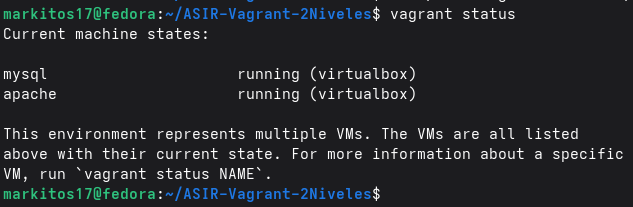

### 8.2 Nombres de las máquinas

Cada máquina tiene como nombre de equipo el nombre del alumno, seguido de su función.

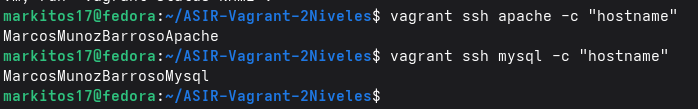

### 8.3 Servicios en ejecución

Servidor web Apache activo en la máquina `apache`:

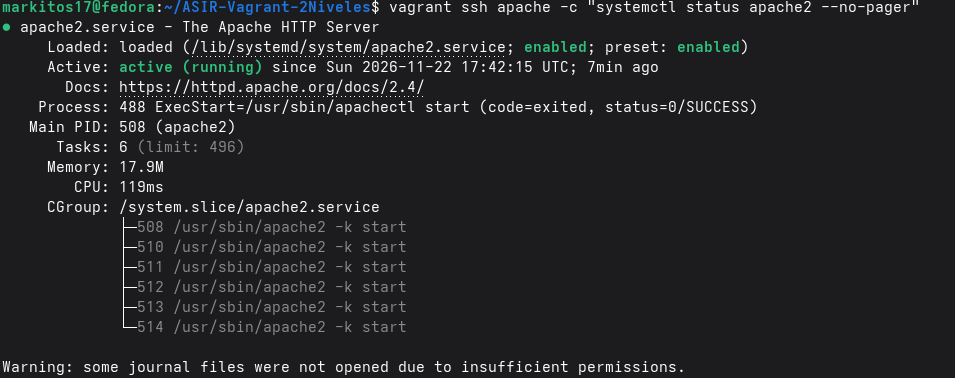

Servidor de base de datos MariaDB activo en la máquina `mysql`:

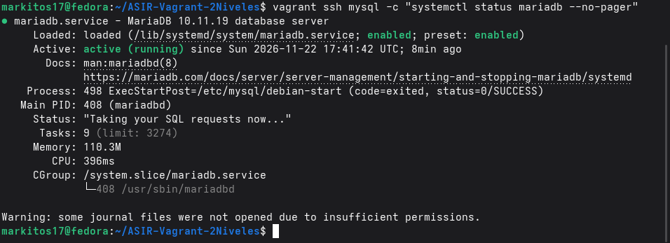

### 8.4 Conectividad de red

**La máquina Apache sí tiene acceso a Internet** (recibe respuesta de `8.8.8.8`):

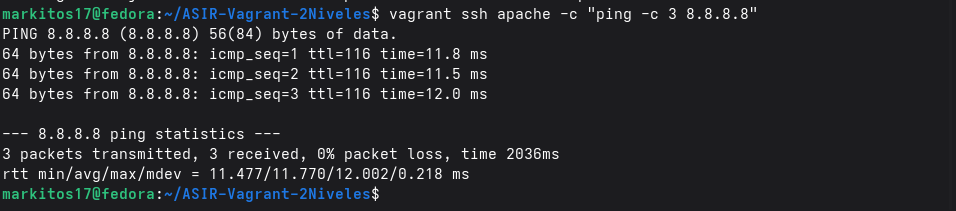

**La máquina MySQL no tiene acceso a Internet**: el mensaje `Network is unreachable` indica que no tiene ninguna ruta hacia el exterior.

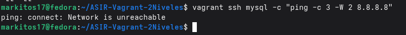

**Las dos máquinas se comunican por la red interna**: Apache llega a MySQL por su IP privada.

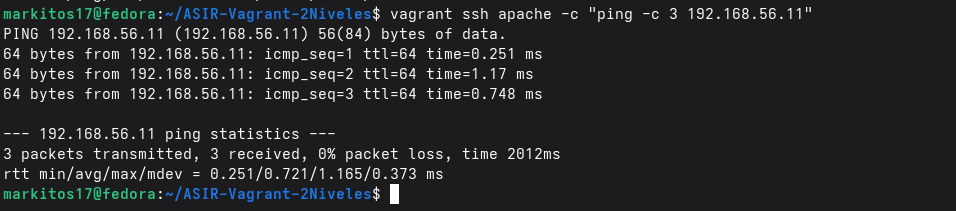

### 8.5 Configuración de la aplicación

Fichero `config.php` en la máquina Apache, con los datos de conexión ya ajustados (apartado 6):

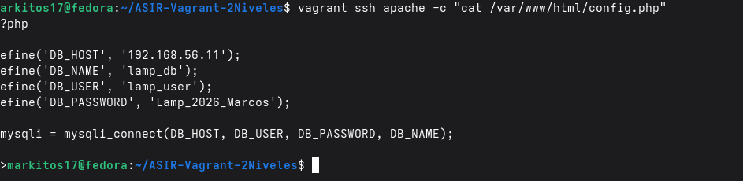

### 8.6 Base de datos

Base de datos `lamp_db` creada en la máquina MySQL y contenido de la tabla `users`:

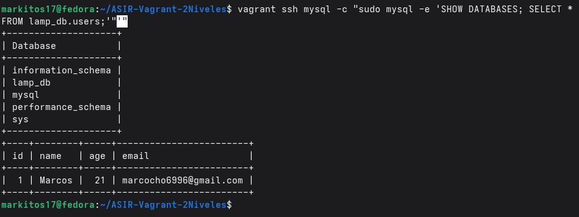

### 8.7 La aplicación en el navegador

Página principal de la aplicación, accesible mediante el reenvío de puertos en `http://localhost:8080`:

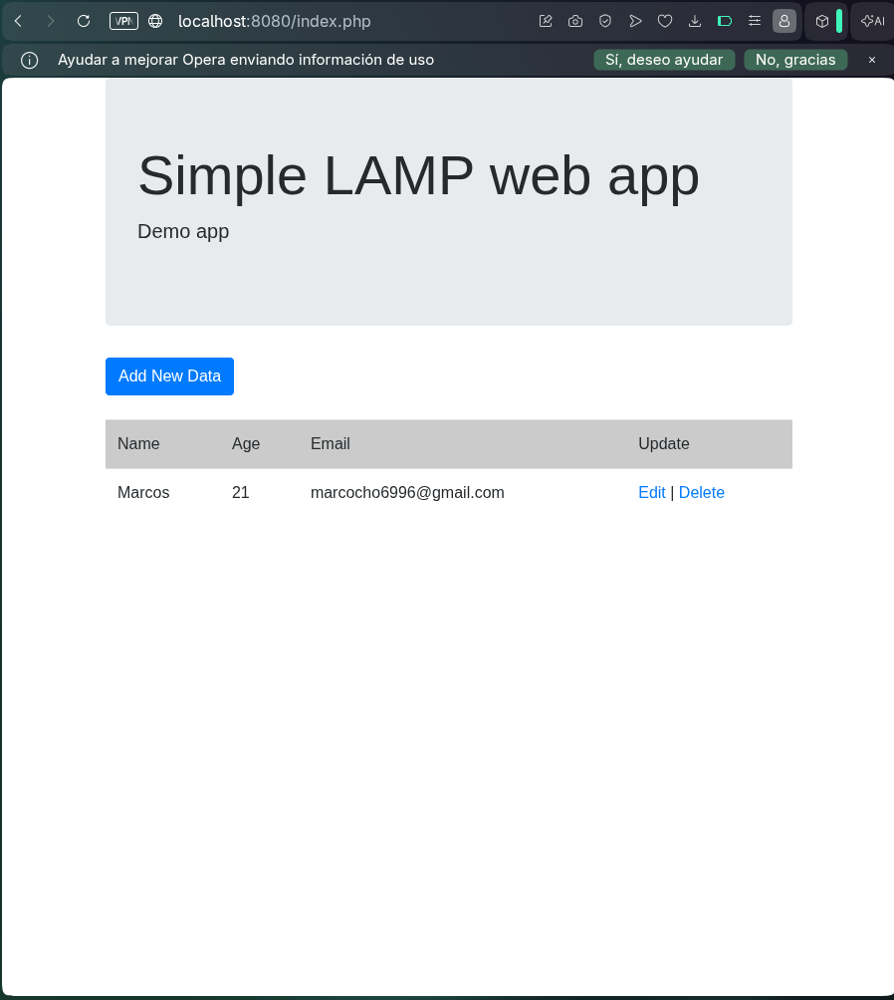

Formulario para añadir un nuevo usuario:

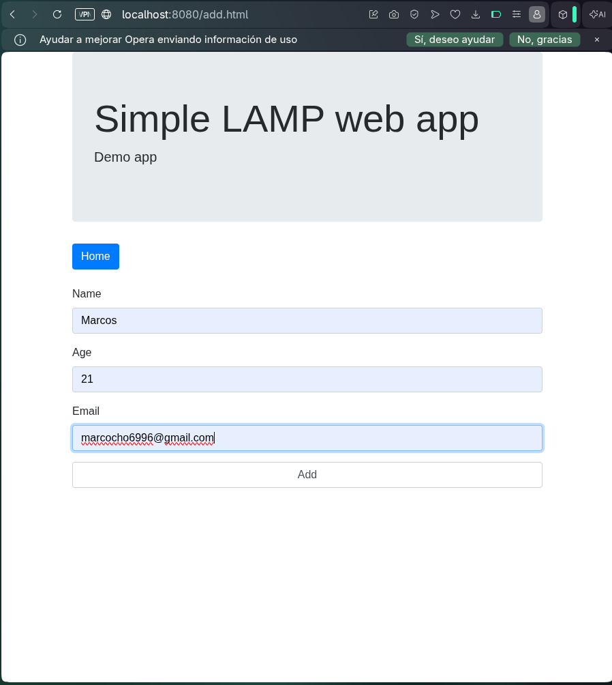

Mensaje de confirmación tras guardar los datos en la base de datos:

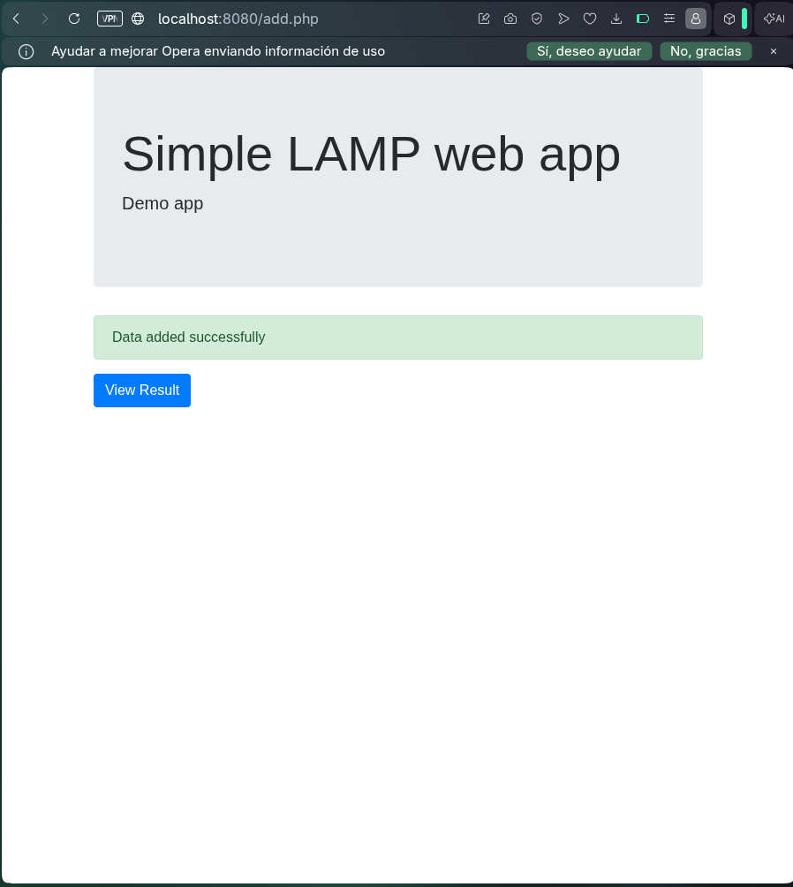

Listado actualizado con el nuevo registro:

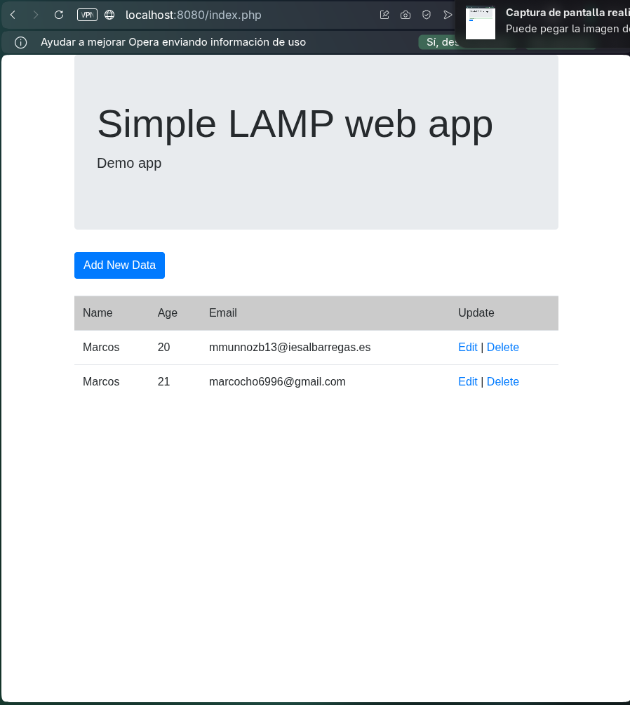

## 9. Screencast

Vídeo donde se aprecia el funcionamiento de la aplicación (alta, edición y borrado de usuarios):

[Ver el screencast](screencast.mp4)

## 10. Aclaraciones

- **MariaDB en lugar de MySQL.** En Debian 12 el paquete `mysql-server` no está en los repositorios oficiales. Se ha usado MariaDB, que es totalmente compatible y funciona con el mismo cliente y con la extensión `php-mysql`.
- **Cómo se deja sin Internet a la máquina MySQL.** Vagrant crea siempre una tarjeta NAT en cada máquina para poder conectarse por SSH. Para que no tenga salida a Internet se elimina su ruta por defecto. La conexión de Vagrant sigue funcionando porque el acceso SSH entra desde el anfitrión por un puerto reenviado y no necesita esa ruta.
- **Orden de los scripts.** La instalación de MariaDB necesita Internet, por eso `sin_internet.sh` se ejecuta siempre después de `mysql.sh`.
- **Seguridad del acceso a la base de datos.** El usuario `lamp_user` solo puede conectarse desde la IP de la máquina Apache y solo tiene permisos sobre la base de datos `lamp_db`.
- **Contraseña de prácticas.** La contraseña que aparece en los scripts es solo para esta práctica y no debe reutilizarse en entornos reales. En un entorno de producción se guardarían las credenciales fuera del repositorio.
- **Reinicio de las máquinas.** Al volver a arrancarlas con `vagrant up`, no se reinstala nada: los servicios y los datos se conservan, y `sin_internet.sh` vuelve a ejecutarse para dejar sin salida a Internet a la máquina MySQL.
