# Práctica Vagrant: infraestructura en dos niveles (Apache y MariaDB)

**Alumno:** Marcos Muñoz Barroso · 2.º ASIR · IES Albarregas

## Índice

1. [Introducción](#1-introducción)
2. [Vagrantfile](#2-vagrantfile)
3. [Scripts de aprovisionamiento](#3-scripts-de-aprovisionamiento)
4. [Ajuste de la aplicación](#4-ajuste-de-la-aplicación)
5. [Comprobaciones](#5-comprobaciones)
6. [Screencast](#6-screencast)

## 1. Introducción

En esta práctica se montan con Vagrant dos máquinas virtuales Debian 12 y se despliega en ellas una aplicación de gestión de usuarios hecha en PHP ([iaw-practica-lamp](https://github.com/josejuansanchez/iaw-practica-lamp)).

| Máquina | Nombre | Función | IP interna | Internet |
|---|---|---|---|---|
| apache | MarcosMunozBarrosoApache | Servidor web | 192.168.56.10 | Sí (NAT) |
| mysql | MarcosMunozBarrosoMysql | Base de datos (MariaDB) | 192.168.56.11 | No |

La aplicación se abre desde el navegador del equipo anfitrión en `http://localhost:8080` mediante reenvío de puertos.

Para hacerla se ha usado Fedora con VirtualBox 7.2.22, Vagrant 2.4.9 y Git 2.53.0.

## 2. Vagrantfile

```ruby
Vagrant.configure("2") do |config|
  config.vm.box = "debian/bookworm64"

  # Máquina de BBDD (sin Internet)
  config.vm.define "mysql" do |mysql|
    mysql.vm.hostname = "MarcosMunozBarrosoMysql"
    mysql.vm.network "private_network", ip: "192.168.56.11",
                     virtualbox__intnet: "red_interna"
    mysql.vm.provision "shell", path: "mysql.sh"
    mysql.vm.provision "shell", path: "sin_internet.sh", run: "always"
  end

  # Máquina Apache (con NAT y port forwarding)
  config.vm.define "apache" do |apache|
    apache.vm.hostname = "MarcosMunozBarrosoApache"
    apache.vm.network "forwarded_port", guest: 80, host: 8080
    apache.vm.network "private_network", ip: "192.168.56.10",
                      virtualbox__intnet: "red_interna"
    apache.vm.provision "shell", path: "apache.sh"
  end
end
```

- `config.vm.box`: imagen base de las dos máquinas (Debian 12).
- `config.vm.define`: define cada máquina. La de MySQL va primero para que se cree antes.
- `vm.hostname`: nombre de la máquina, con mi nombre.
- `private_network` con `virtualbox__intnet`: red interna entre las dos máquinas, con IP fija.
- `forwarded_port`: el puerto 8080 del equipo va al puerto 80 de Apache.
- `vm.provision "shell"`: ejecuta un script de Bash al crear la máquina.
- `run: "always"`: el script se ejecuta en cada arranque.

## 3. Scripts de aprovisionamiento

### mysql.sh

```bash
#!/bin/bash
# Variables de la base de datos
DB_NAME="lamp_db"
DB_USER="lamp_user"
DB_PASS="Lamp_2026_Marcos"
APACHE_IP="192.168.56.10"
MYSQL_IP="192.168.56.11"

export DEBIAN_FRONTEND=noninteractive

# Actualiza la lista de paquetes e instala MariaDB (el equivalente a MySQL en Debian 12)
apt-get update
apt-get install -y mariadb-server

# Hace que MariaDB escuche en la IP de la red interna en vez de solo en localhost
sed -i "s/^bind-address.*/bind-address = ${MYSQL_IP}/" /etc/mysql/mariadb.conf.d/50-server.cnf
systemctl restart mariadb

# Crea la base de datos, el usuario (solo accesible desde Apache) y la tabla de la aplicación
mysql <<SQL
CREATE DATABASE IF NOT EXISTS ${DB_NAME} CHARACTER SET utf8mb4;
CREATE USER IF NOT EXISTS '${DB_USER}'@'${APACHE_IP}' IDENTIFIED BY '${DB_PASS}';
GRANT ALL PRIVILEGES ON ${DB_NAME}.* TO '${DB_USER}'@'${APACHE_IP}';
FLUSH PRIVILEGES;
USE ${DB_NAME};
CREATE TABLE IF NOT EXISTS users (
  id INT UNSIGNED AUTO_INCREMENT PRIMARY KEY,
  name VARCHAR(100) NOT NULL,
  age INT UNSIGNED NOT NULL,
  email VARCHAR(100) UNIQUE NOT NULL
) ENGINE=InnoDB DEFAULT CHARSET=utf8;
SQL
```

- Las primeras líneas guardan en variables el nombre de la base de datos, el usuario, la contraseña y las IP.
- `export DEBIAN_FRONTEND=noninteractive`: evita que la instalación haga preguntas.
- `apt-get update` y `apt-get install -y mariadb-server`: actualizan los paquetes e instalan MariaDB (en Debian 12 no existe `mysql-server`).
- `sed -i ... bind-address`: cambia la configuración para que MariaDB acepte conexiones por la red interna.
- `systemctl restart mariadb`: reinicia el servicio para aplicar el cambio.
- `mysql <<SQL ... SQL`: ejecuta las sentencias SQL:
  - `CREATE DATABASE`: crea la base de datos.
  - `CREATE USER`: crea el usuario, que solo puede conectarse desde la IP de Apache.
  - `GRANT ALL PRIVILEGES`: le da permisos solo sobre esa base de datos.
  - `FLUSH PRIVILEGES`: recarga los permisos.
  - `CREATE TABLE`: crea la tabla `users` de la aplicación.

### sin_internet.sh

```bash
#!/bin/bash
# Elimina la ruta por defecto: la máquina deja de tener salida a Internet.
# El acceso SSH de Vagrant sigue funcionando porque entra por la red NAT local.
ip route del default || true
```

- `ip route del default`: borra la ruta por defecto, que es la que da salida a Internet. Así la máquina solo ve la red interna.
- `|| true`: evita que el script dé error si la ruta ya no existe.
- Se ejecuta después de `mysql.sh` porque MariaDB necesita Internet para instalarse, y siempre (`run: "always"`) porque la ruta vuelve a aparecer al reiniciar.

### apache.sh

```bash
#!/bin/bash
# Datos de conexión (deben coincidir con los de mysql.sh)
DB_NAME="lamp_db"
DB_USER="lamp_user"
DB_PASS="Lamp_2026_Marcos"
MYSQL_IP="192.168.56.11"

export DEBIAN_FRONTEND=noninteractive

# Instala Apache, PHP con el módulo para MySQL, Git y el cliente de MariaDB
apt-get update
apt-get install -y apache2 php libapache2-mod-php php-mysql git mariadb-client

# Descarga la aplicación desde GitHub
rm -rf /tmp/app
git clone https://github.com/josejuansanchez/iaw-practica-lamp.git /tmp/app

# Copia el código de la aplicación al directorio web
rm -f /var/www/html/index.html
cp -r /tmp/app/src/* /var/www/html/

# Ajusta config.php para que use la base de datos de la otra máquina
sed -i "s/define('DB_HOST', 'localhost');/define('DB_HOST', '${MYSQL_IP}');/" /var/www/html/config.php
sed -i "s/database_name_here/${DB_NAME}/" /var/www/html/config.php
sed -i "s/username_here/${DB_USER}/" /var/www/html/config.php
sed -i "s/password_here/${DB_PASS}/" /var/www/html/config.php

# Permisos y reinicio del servidor web
chown -R www-data:www-data /var/www/html
systemctl restart apache2
```

- Las variables deben coincidir con las de `mysql.sh`.
- `apt-get install -y apache2 php ...`: instala Apache, PHP, el módulo de PHP para Apache, la extensión para MySQL, Git y el cliente de MariaDB.
- `git clone`: descarga la aplicación desde GitHub.
- `rm -f /var/www/html/index.html`: quita la página de bienvenida de Apache.
- `cp -r /tmp/app/src/* /var/www/html/`: copia la aplicación a la carpeta que sirve Apache.
- Las cuatro órdenes `sed -i`: cambian los valores de ejemplo de `config.php` por los reales.
- `chown -R www-data:www-data`: da los ficheros al usuario de Apache.
- `systemctl restart apache2`: reinicia Apache.

## 4. Ajuste de la aplicación

El fichero `config.php` de la aplicación conecta con la base de datos en `localhost`. Como la base de datos está en otra máquina, `apache.sh` lo cambia automáticamente:

| Constante | Valor original | Valor final |
|---|---|---|
| `DB_HOST` | `localhost` | `192.168.56.11` |
| `DB_NAME` | `database_name_here` | `lamp_db` |
| `DB_USER` | `username_here` | `lamp_user` |
| `DB_PASSWORD` | `password_here` | la de los scripts |

## 5. Comprobaciones

Para levantar las máquinas se usa `vagrant up`.

**Las dos máquinas están en marcha:**

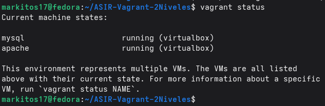

**Cada máquina tiene mi nombre:**

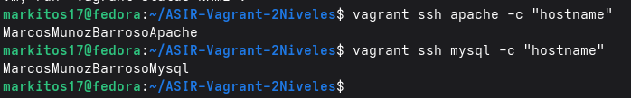

**Apache funcionando:**

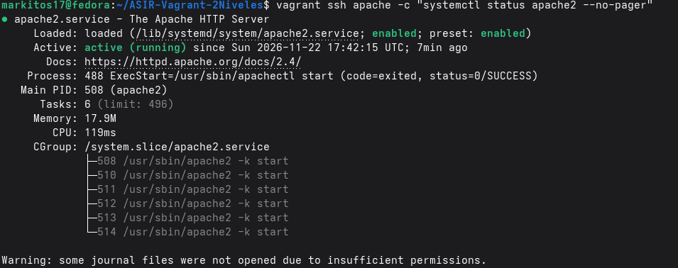

**MariaDB funcionando:**

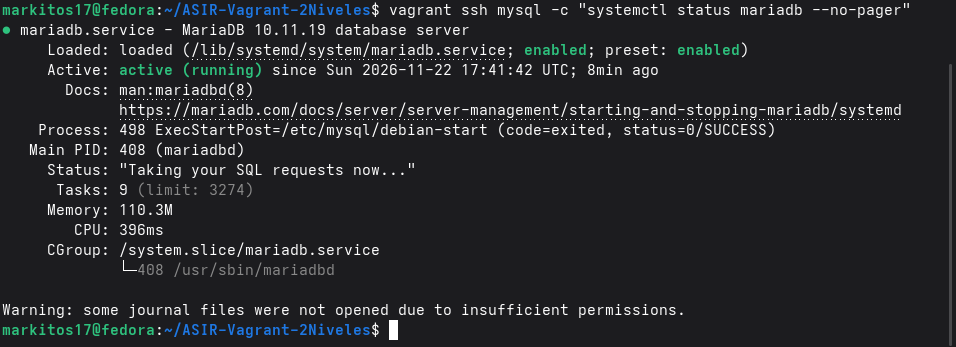

**Apache tiene Internet:**

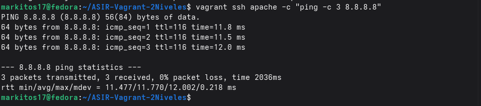

**MySQL no tiene Internet:**

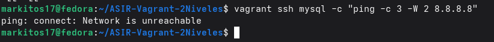

**Apache llega a MySQL por la red interna:**

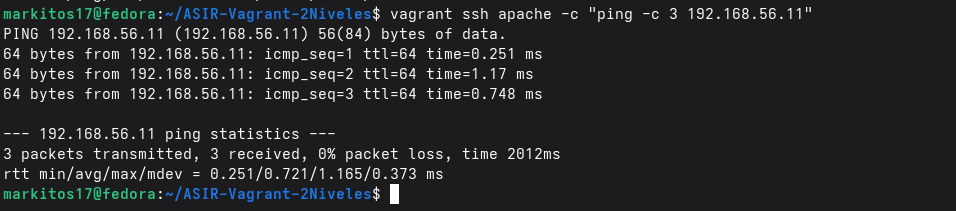

**Fichero `config.php` ya ajustado:**

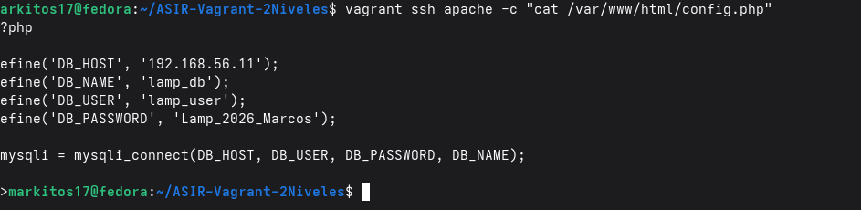

**Base de datos creada:**

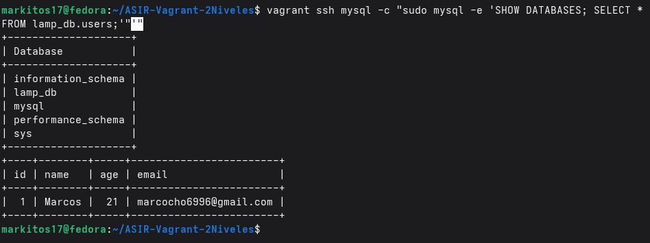

**La aplicación en el navegador (`http://localhost:8080`):**

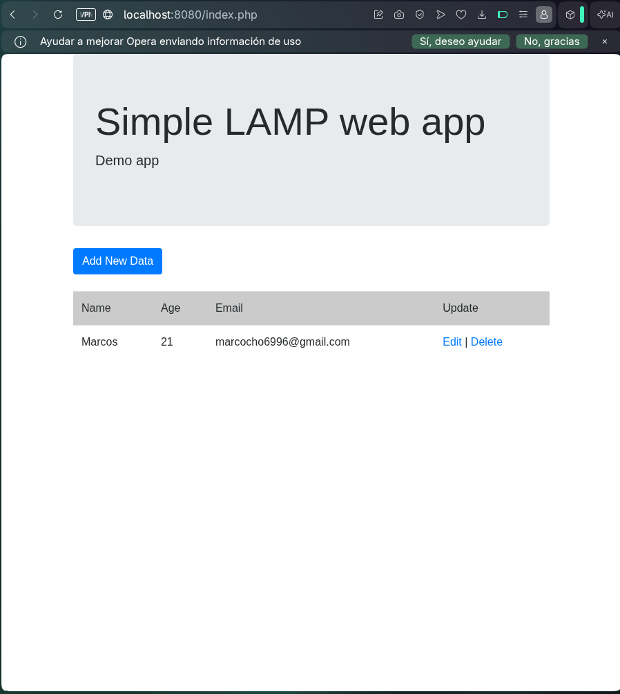

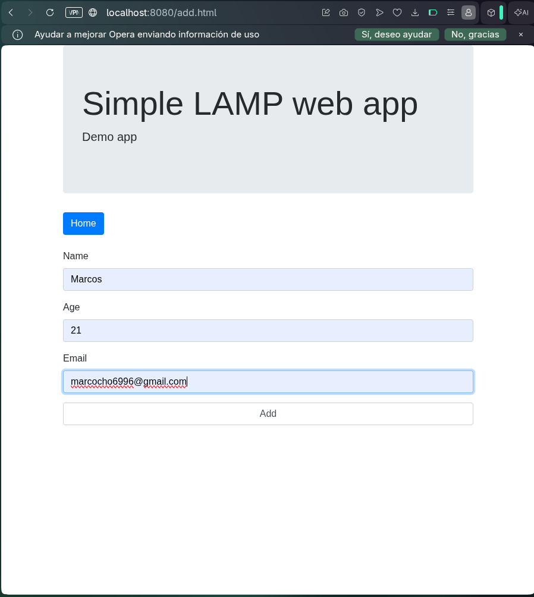

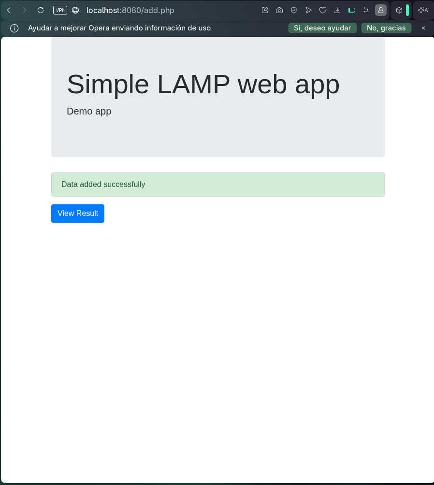

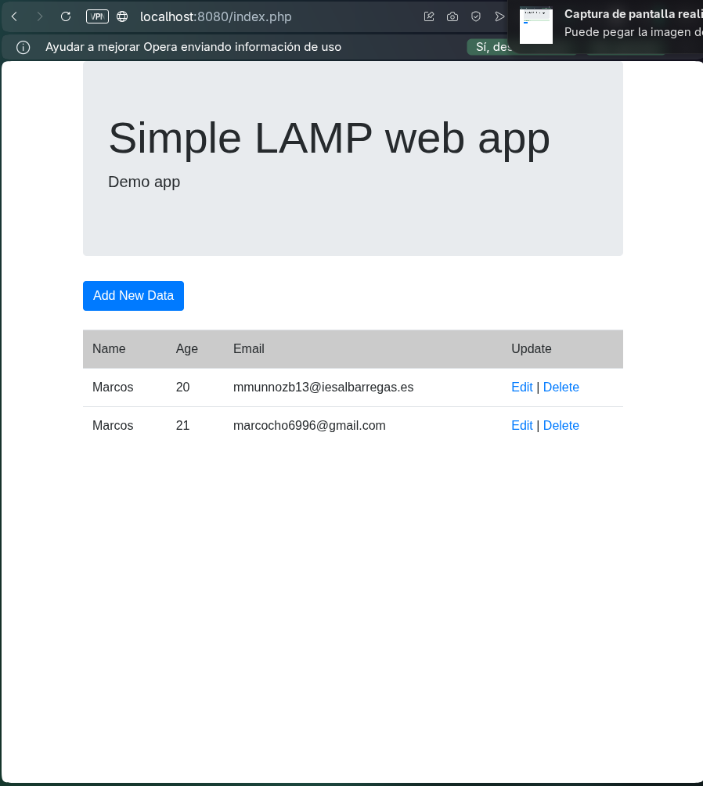

## 6. Screencast

Vídeo del funcionamiento de la aplicación: [screencast.webm](https://github.com/user-attachments/assets/6fe8ee8e-0185-4487-9439-224d2ca07147)

